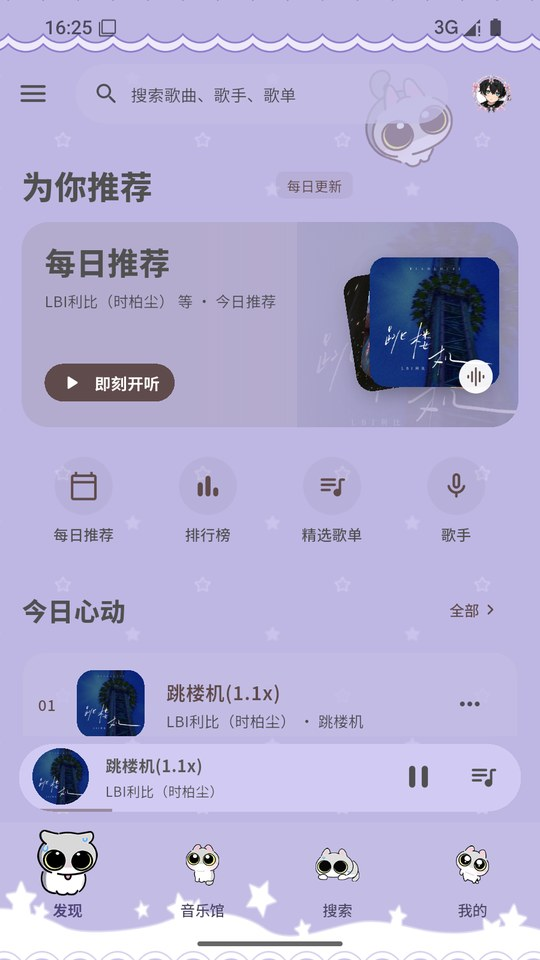
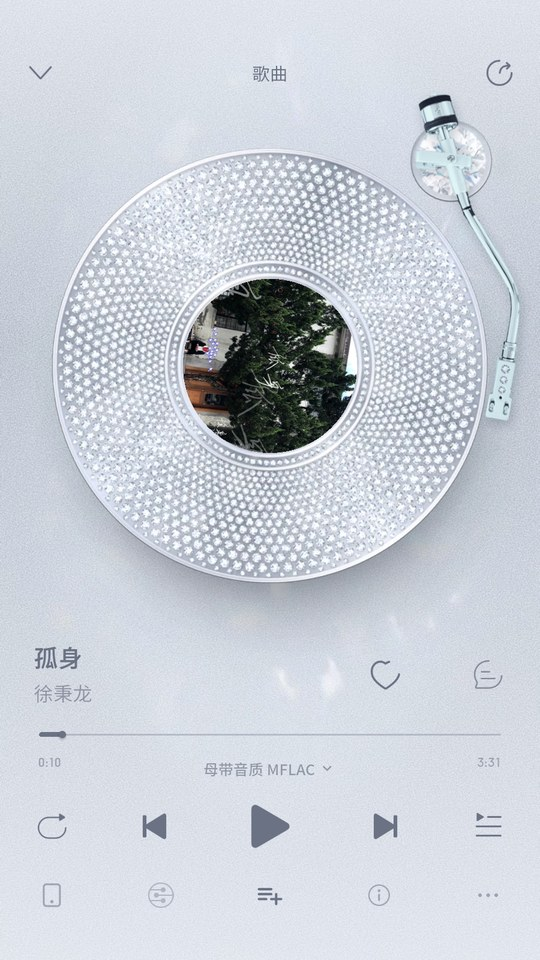
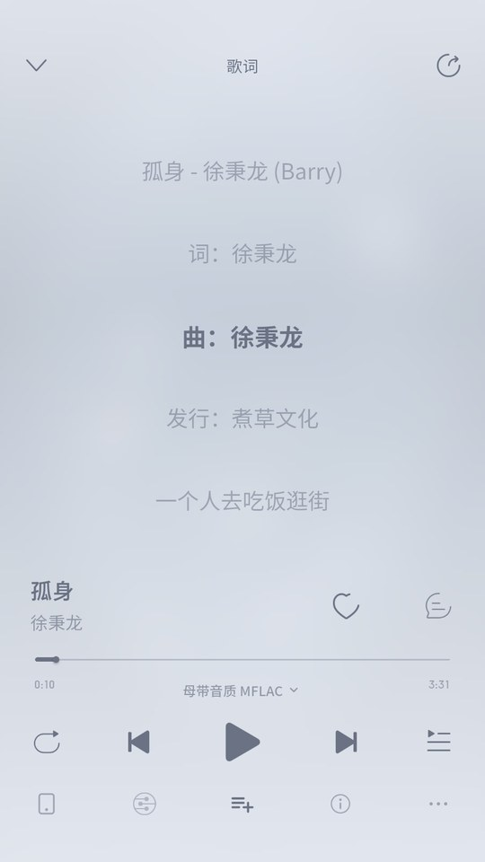
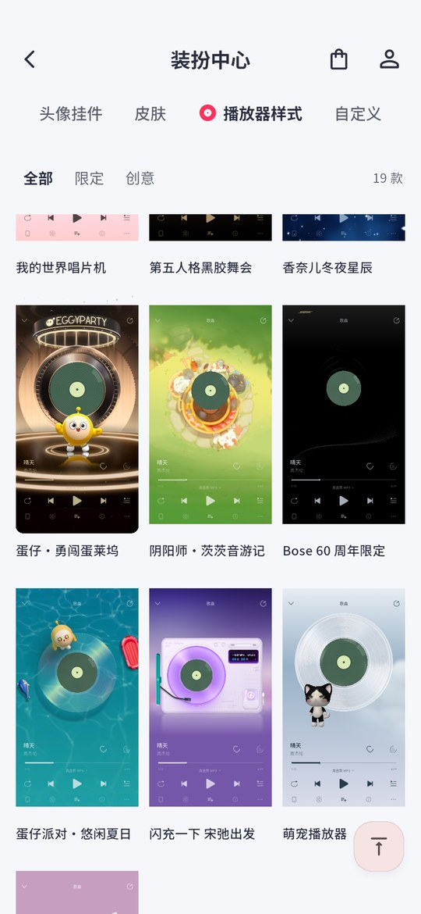
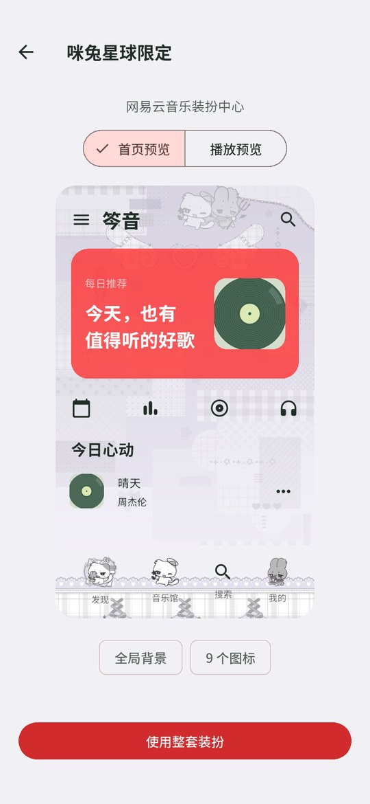
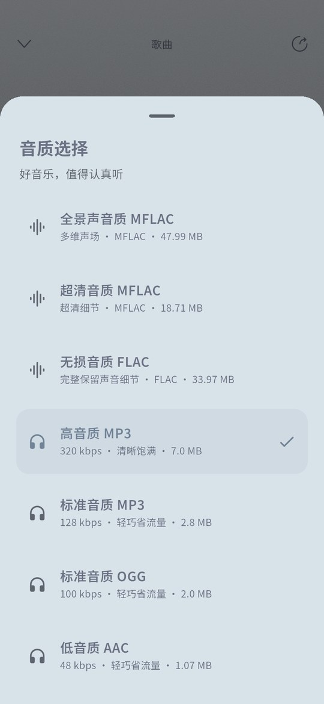
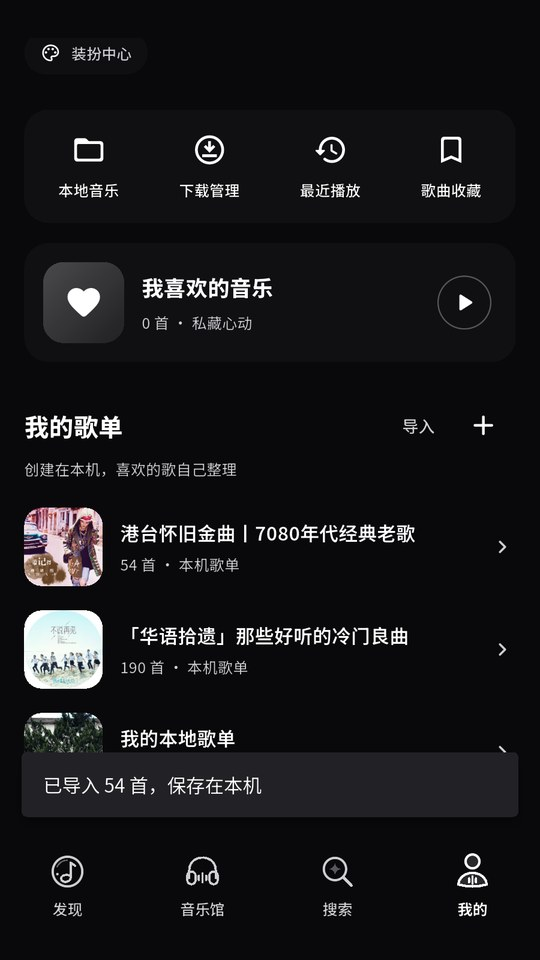
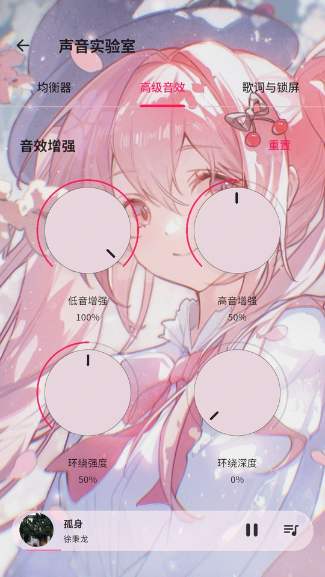
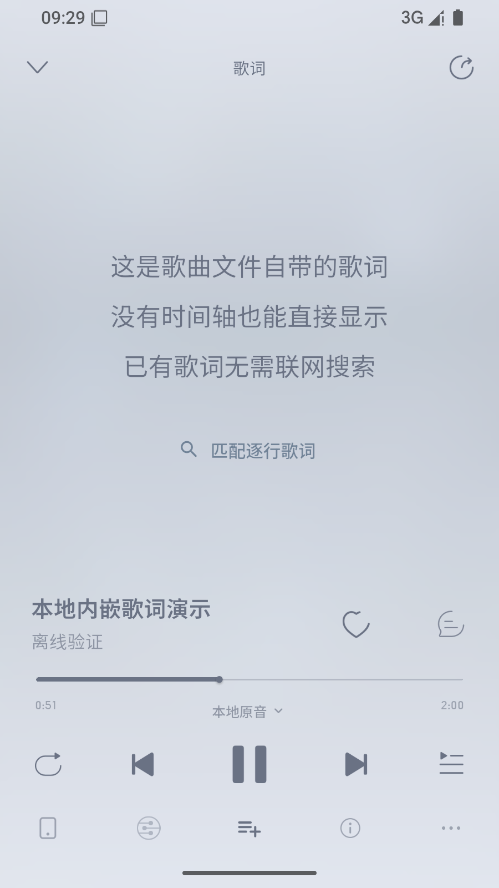
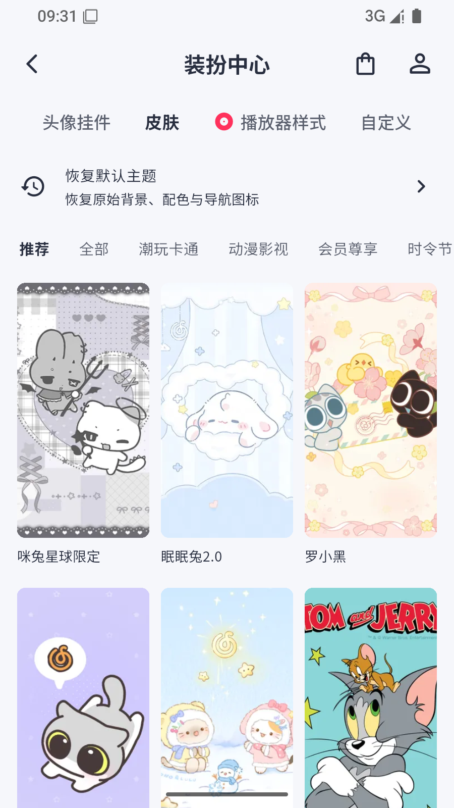

# 笒音2.0

### 让每一首喜欢的歌，都有自己的模样。

Android / iOS 音乐播放器 · 个性装扮 · 沉浸歌词 · 本地歌单

**[国内加速下载 · 手机推荐](https://v4.gh-proxy.org/https://github.com/cenguigui/CenYin-2.0/releases/download/v2.0.1/CenYin-2.0.1-arm64-v8a.apk)**　｜　**[GitHub 下载](https://github.com/cenguigui/CenYin-2.0/releases/download/v2.0.1/CenYin-2.0.1-arm64-v8a.apk)**　｜　[使用说明](docs/USAGE.md)

笒音2.0 是一款支持 Android 与 iOS 的音乐应用，将发现音乐、播放、歌词、主题装扮和本地歌单放在一起。这个仓库提供安装包发布、中文说明和应用演示；应用源代码不公开。

> 项目名称为「笒音2.0」，本次发布的 Android 安装包版本为 **2.0.1**。

## iOS 版

**[下载 iOS 未签名 IPA · 构建 12](https://github.com/cenguigui/CenYin-2.0/releases/tag/v2.0.1-ios.12)** · [更新与安装说明](docs/ios-build-12.md) · [19 款播放器截图](docs/screenshots/ios-player-styles/README.md)

iOS 15.0 及以上，arm64 真机 Release，需要自行签名安装。

## 界面演示

以下均为应用实际运行截图，主题、播放器和夜间模式可独立切换。点击图片可查看大图。

| 发现音乐 | 沉浸播放 | 同步歌词 |
| :---: | :---: | :---: |
|  |  |  |

| 主题装扮 | 播放器样式 | 实际换肤预览 |
| :---: | :---: | :---: |
|  |  |  |

| 音质选择 | 本地歌单与夜间模式 | 高级音效 |
| :---: | :---: | :---: |
|  |  |  |

### 2.0.1 新增与修复

| 本地文件自带歌词 | 恢复默认主题入口 |
| :---: | :---: |
|  |  |

## 下载与安装

支持 **Android 7.0 及以上**。绝大多数近年手机请选择 **ARM64**；x86_64 用于对应架构的模拟器。

| 安装包 | 适用设备 | 大小 | 国内加速 | GitHub 原始下载 |
| --- | --- | ---: | --- | --- |
| **ARM64（推荐）** | 大多数 Android 手机 | 186.0 MiB | [IPv4 优选](https://v4.gh-proxy.org/https://github.com/cenguigui/CenYin-2.0/releases/download/v2.0.1/CenYin-2.0.1-arm64-v8a.apk) · [主站备用](https://gh-proxy.org/https://github.com/cenguigui/CenYin-2.0/releases/download/v2.0.1/CenYin-2.0.1-arm64-v8a.apk) | [下载](https://github.com/cenguigui/CenYin-2.0/releases/download/v2.0.1/CenYin-2.0.1-arm64-v8a.apk) |
| ARMv7 | 较旧的 32 位手机 | 183.8 MiB | [IPv4 优选](https://v4.gh-proxy.org/https://github.com/cenguigui/CenYin-2.0/releases/download/v2.0.1/CenYin-2.0.1-armeabi-v7a.apk) · [主站备用](https://gh-proxy.org/https://github.com/cenguigui/CenYin-2.0/releases/download/v2.0.1/CenYin-2.0.1-armeabi-v7a.apk) | [下载](https://github.com/cenguigui/CenYin-2.0/releases/download/v2.0.1/CenYin-2.0.1-armeabi-v7a.apk) |
| x86_64 | x86_64 Android 模拟器 | 187.5 MiB | [IPv4 优选](https://v4.gh-proxy.org/https://github.com/cenguigui/CenYin-2.0/releases/download/v2.0.1/CenYin-2.0.1-x86_64.apk) · [主站备用](https://gh-proxy.org/https://github.com/cenguigui/CenYin-2.0/releases/download/v2.0.1/CenYin-2.0.1-x86_64.apk) | [下载](https://github.com/cenguigui/CenYin-2.0/releases/download/v2.0.1/CenYin-2.0.1-x86_64.apk) |

下载入口已于 2026-10-18 更新为 GH-Proxy 多线路：默认使用 IPv4 优选，另提供主站、IPv4/IPv6、Fastly 和 AxisNow 备用。[查看全部下载线路](docs/DOWNLOAD.md)。这些是第三方公共代理，不代表所有地区、运营商或浏览器均可访问；下载失败时请切换节点，也可复制地址到手机浏览器打开。安装包校验值见 [SHA256SUMS.txt](SHA256SUMS.txt)。

下载 APK 后在手机中打开，根据系统提示允许当前浏览器或文件管理器安装应用。更新时直接覆盖安装；更换设备或卸载前，先导出需要保留的本地歌单。

## 可以做什么

- **发现与搜索**：推荐歌曲、榜单、歌单、歌手、专辑和 MV，支持搜索联想与可删除的搜索历史。
- **沉浸播放**：后台播放、锁屏控制、播放队列、进度拖动；封面与歌词左右滑动，播放器展开和收起带过渡动画。
- **个性装扮**：主题皮肤、头像挂件、播放器样式和自定义装扮；主题联动导航、菜单和控件，详情中可预览实际效果。
- **清晰的夜间模式**：开启后各主题页面统一使用暗色背景和浅色文字。
- **本地歌单**：创建、编辑、排序、收藏、分享、导入与导出；歌单资料保存在设备，无需自建后端。
- **分享与解析导入**：支持酷我电脑端、手机端公开歌单链接，也支持公开网易云歌单、笒音歌单文件和 TXT/M3U 清单；导入前可预览，合并时去重。
- **音质与音效**：音质选择展示歌曲可用档位和对应文件大小，声音实验室提供均衡器及低音、高音、环绕等高级设置。
- **适合 Android 的交互**：下拉刷新、上滑加载、长列表返回顶部、全面屏手势和中文提示。

音质档位、评论、在线曲目和公开歌单内容以服务实际返回为准；某些音效的可用范围取决于 Android 设备。跨平台歌单导入会匹配歌曲版本，保存前可以核对。

## 本次更新

- 修复本地音乐扫描与曲终切歌重播旧歌开头的问题。
- 读取本地内嵌歌词、同名 LRC，支持无时间轴原文显示、在线匹配与已有歌词文件导入。
- 保存本地歌单时保留歌词和已下载文件路径。
- 下载前选择格式与音质，显示真实文件大小；播放档位按实际音源显示。
- 装扮中心「皮肤」页新增「恢复默认主题」。

当前安装包为 **2.0.1（构建 10）**。通过 **211 项单元与组件测试**、静态分析和 **3 项安卓歌词专项测试**，正式 APK 已在 Android 15 模拟器安装复查。完整更新说明见 [CHANGELOG.md](CHANGELOG.md)。

## 反馈

请通过 [Issues](https://github.com/cenguigui/CenYin-2.0/issues/new) 反馈，附上手机型号、Android 版本、安装包版本、复现步骤及截图。提交截图前请检查是否包含个人信息。

本仓库只维护发布说明、演示图片和 Release 安装包；GitHub 自动生成的 “Source code” 压缩包也仅包含这些公开资料。第三方组件及素材说明见 [NOTICE.md](NOTICE.md)。

