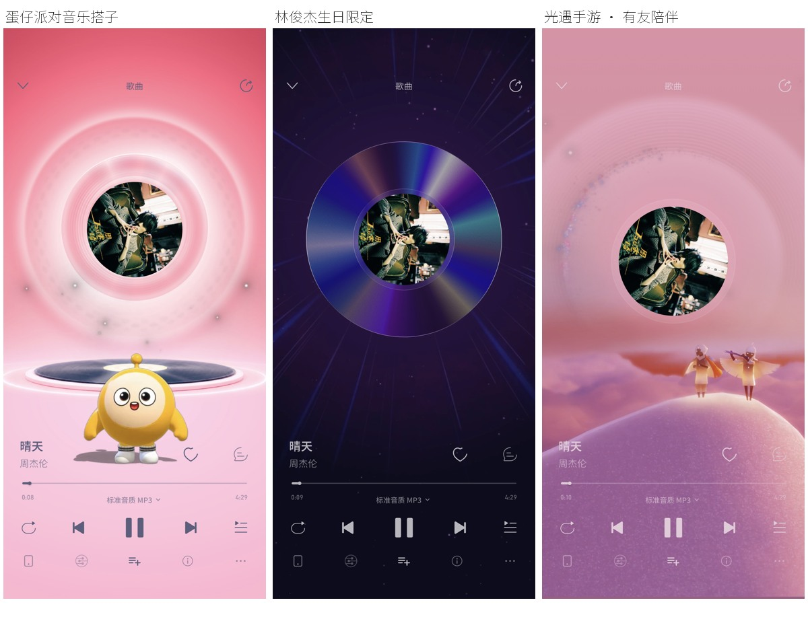

# iOS 播放器圆心复核

2026-10-19，在独立 iPhone 17 Pro / iOS 26.5 模拟器运行真实应用，播放《晴天》，分别截取播放和暂停画面。保留用户原模拟器应用与资料。

蛋仔的静态背景光环、林俊杰的动态背景光束使用完整视口计算装饰偏移，歌曲封面的原始高度和大小保持不变。光遇的封面与前景圆环继续使用同一舞台中心，重新检查播放、暂停画面。

| 样式 | 播放 | 暂停 |
| --- | --- | --- |
| 蛋仔派对音乐搭子 | [原图](limited_21047503-playing.jpg) | [原图](limited_21047503-paused.jpg) |
| 林俊杰生日限定 | [原图](limited_19678503-playing.jpg) | [原图](limited_19678503-paused.jpg) |
| 光遇手游 · 有友陪伴 | [原图](limited_260010-playing.jpg) | [原图](limited_260010-paused.jpg) |
